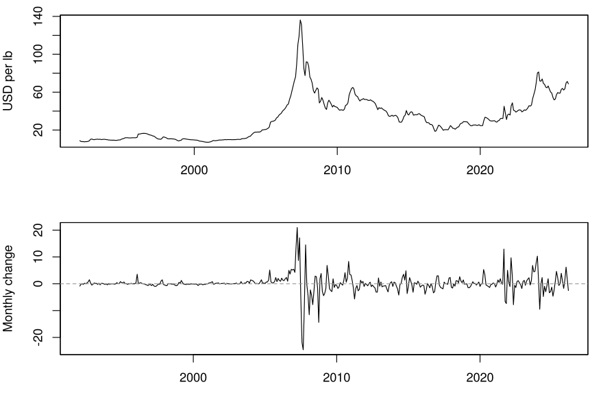
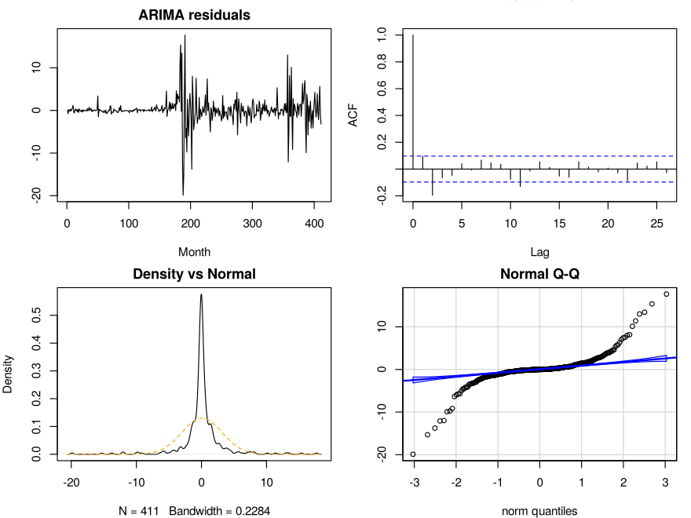
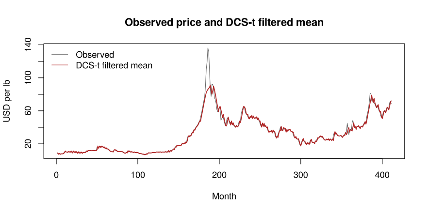
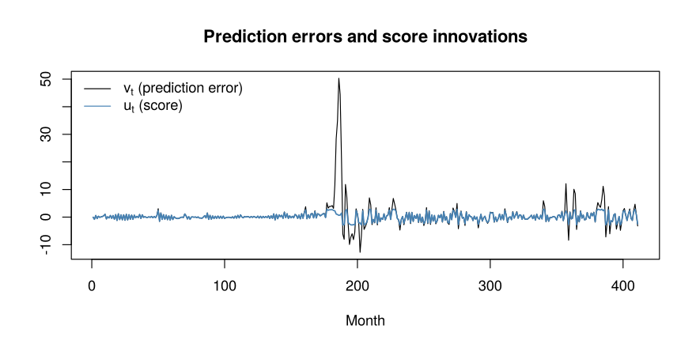

Score-driven modelling of the global uranium price
================

A comparison of a Gaussian **ARIMA(1,1,0)** with a robust **Student-t
score-driven (DCS-t) model** for the monthly Global Price of Uranium
(IMF, via FRED series
[PURANUSDM](https://fred.stlouisfed.org/series/PURANUSDM)), January 1992
– March 2026.

*Coursework for Advanced Time Series, MSc in Statistical Sciences,
University of Bologna, by **Alessandro Baroni, Mohammadmahdi
Ameridaragheh and Leonardo Bizzotto**. This repository is a cleaned-up,
fully reproducible version: the DCS-t filter and estimator in
[`dcs_t.R`](dcs_t.R) are a fresh implementation, and estimation now uses
multiple starting points (see [Note on
estimation](#note-on-estimation)).*

## Why a score-driven model?

Uranium is a thin, contract-driven market. A few events (the 2006 Cigar
Lake mine flood, the 2011 Fukushima accident, the 2021 launch of the
Sprott Physical Uranium Trust and the 2022 invasion of Ukraine) have
moved the price by tens of dollars per pound within months. The result
is a non-stationary series with volatility clustering and very
heavy-tailed changes, which is exactly where a Gaussian filter
struggles.

A DCS model updates the latent mean with the **score** of the
conditional density instead of the raw prediction error
$v_t = y_t - \mu_t$. Under a Student-t density, that score is

$$u_t = \frac{v_t}{1 + v_t^2/(\nu\varsigma)}, \qquad \mu_{t+1} = \omega + \phi(\mu_t - \omega) + \kappa u_t .$$

It behaves like $v_t$ for small errors but is bounded and
*redescending*, so extreme observations are automatically downweighted
(Harvey, 2013; Creal, Koopman & Lucas, 2013).

## Data

``` r
d   <- read.csv("PURANUSDM.csv")
y   <- zoo(d$PURANUSDM, as.Date(d$observation_date))
obs <- as.numeric(y)
c(n = length(obs), missing = sum(is.na(obs)))
```

    ##       n missing 
    ##     411       0

``` r
par(mfrow = c(2, 1), mar = c(4, 4, 1, 1))
plot(y, xlab = "", ylab = "USD per lb")
plot(diff(y), xlab = "", ylab = "Monthly change"); abline(h = 0, col = "grey60", lty = 2)
```

<!-- -->

The level peaks at about 136 USD/lb in mid-2007, almost twenty times its
1992 value. In levels, the ACF decays slowly and the PACF has a single
spike at lag 1. That points to a unit root, so the benchmark is fitted
to the first differences. The monthly changes show two clear turbulent
regimes: 2006–2008 and after 2020.

## Benchmark: ARIMA(1,1,0)

``` r
arima_fit <- arima(obs, order = c(1, 1, 0), method = "ML")
arima_fit
```

    ## 
    ## Call:
    ## arima(x = obs, order = c(1, 1, 0), method = "ML")
    ## 
    ## Coefficients:
    ##          ar1
    ##       0.4244
    ## s.e.  0.0446
    ## 
    ## sigma^2 estimated as 9.398:  log likelihood = -1041.18,  aic = 2086.35

``` r
res_arima <- residuals(arima_fit)

par(mfrow = c(2, 2), mar = c(4, 4, 2, 1))
plot(res_arima, type = "l", main = "ARIMA residuals", ylab = "", xlab = "Month")
acf(res_arima, main = "Residual ACF")
plot(density(res_arima), main = "Density vs Normal")
curve(dnorm(x, mean(res_arima), sd(res_arima)), add = TRUE, col = "orange", lty = 2)
qqPlot(res_arima, main = "Normal Q-Q", ylab = "", id = FALSE)
```

<!-- -->

``` r
shapiro.test(res_arima)
```

    ## 
    ##  Shapiro-Wilk normality test
    ## 
    ## data:  res_arima
    ## W = 0.71836, p-value < 2.2e-16

The ARIMA takes care of the linear memory: its residual ACF is mostly
inside the bands. But the residuals are heavily leptokurtic and show
volatility clustering, and Shapiro–Wilk rejects normality (p \< 0.001).
The Gaussian likelihood is the wrong tool for this series.

## DCS-t model

``` r
fit <- dcs_t_fit_multistart(obs, n_starts = 60)
round(fit$theta, 3)
```

    ##    omega      phi    kappa varsigma       nu 
    ##    8.791    0.999    1.950    5.184    6.344

``` r
filt <- dcs_t_filter(obs, fit$theta)
```

``` r
plot(obs, type = "l", col = "grey40", xlab = "Month", ylab = "USD per lb",
     main = "Observed price and DCS-t filtered mean")
lines(filt$mu, col = "firebrick", lwd = 1.5)
legend("topleft", c("Observed", "DCS-t filtered mean"), col = c("grey40", "firebrick"),
       lty = 1, bty = "n")
```

<!-- -->

``` r
plot(filt$v, type = "l", ylab = "", xlab = "Month",
     main = "Prediction errors and score innovations")
lines(filt$u, col = "steelblue", lwd = 1.5)
legend("topleft", c(expression(v[t] ~ "(prediction error)"), expression(u[t] ~ "(score)")),
       col = c("black", "steelblue"), lty = 1, bty = "n")
```

<!-- -->

The score clips the extreme errors of 2007 and 2021–2022: the largest
prediction error is 50.3 USD/lb, but the largest score innovation is
only 2.9. A single shock therefore cannot drag the filtered mean around
for months.

The estimates are as follows:

- **φ = 0.999:** this is at the edge of stationarity, matching the
  unit-root behaviour seen in the ACF.
- **κ = 1.95:** once the score has shrunk the outliers, the filter
  reacts strongly to new information.
- **ν = 6.3:** the tails are much heavier than Gaussian (a Gaussian
  corresponds to ν → ∞).

## Model comparison

``` r
aic <- c("ARIMA(1,1,0)" = arima_fit$aic, "DCS-t" = fit$aic)
round(aic, 1)
```

    ## ARIMA(1,1,0)        DCS-t 
    ##       2086.4       1986.8

The DCS-t lowers the AIC by **100 points**, far beyond the ΔAIC \> 10
rule of thumb (Burnham & Anderson, 2002), despite having three more
parameters. The gain comes from three things:

- **Heavy tails:** the Student-t gives far more likelihood to the 2007
  and 2021–2022 moves.
- **Robustness:** the bounded score stops one-off shocks from biasing
  the filter.
- **Adaptive updates:** the filter updates more slowly in turbulent
  periods and faster in calm ones.

## Note on estimation

The likelihood surface is multimodal, because ω is weakly identified
when φ ≈ 1. The original coursework used a single starting point, (0,
0.9, 0.7, 1, 2). From there the optimiser stops at a local optimum with
ν ≈ 3.6 and an AIC gap of about 46.

``` r
local <- dcs_t_fit(obs, start = c(0, 0.9, 0.7, 1, 2.2))
round(c(local$theta, AIC = local$aic), 3)
```

    ##    omega      phi    kappa varsigma       nu      AIC 
    ##    8.918    0.997    1.979    4.575    3.631 2040.163

Restarting from 60 random points finds a better optimum (AIC 1986.8 vs
2040.2). This makes the case for the DCS-t even stronger and gives a
less extreme ν. The conclusions do not change, but the lesson is a good
one: always use multiple starting points for non-linear likelihoods.

The estimator recovers known parameters from simulated data:

``` r
set.seed(1)
true <- c(omega = 10, phi = 0.95, kappa = 0.8, varsigma = 2, nu = 4)
sim  <- dcs_t_simulate(2000, true)
round(rbind(true = true, estimated = dcs_t_fit_multistart(sim$y, 20)$theta), 3)
```

    ##            omega   phi kappa varsigma    nu
    ## true      10.000 0.950 0.800    2.000 4.000
    ## estimated 10.696 0.961 0.834    1.953 3.774

## Possible extensions

- A score-driven recursion for the scale (location and scale DCS-t) to
  model volatility clustering directly
- Skewed or generalised hyperbolic densities
- A multivariate model linking uranium to other energy commodities

## Reproduce

``` r
install.packages(c("zoo", "car", "rmarkdown"))
rmarkdown::render("README.Rmd")
```

## References

- Creal, D., Koopman, S. J. & Lucas, A. (2013). Generalized
  autoregressive score models with applications. *Journal of Applied
  Econometrics*, 28(5), 777–795.
- Harvey, A. C. (2013). *Dynamic Models for Volatility and Heavy Tails*.
  Cambridge University Press.
- Burnham, K. P. & Anderson, D. R. (2002). *Model Selection and
  Multimodel Inference* (2nd ed.). Springer.
- International Monetary Fund. Global price of Uranium \[PURANUSDM\],
  retrieved from FRED, Federal Reserve Bank of St. Louis.
